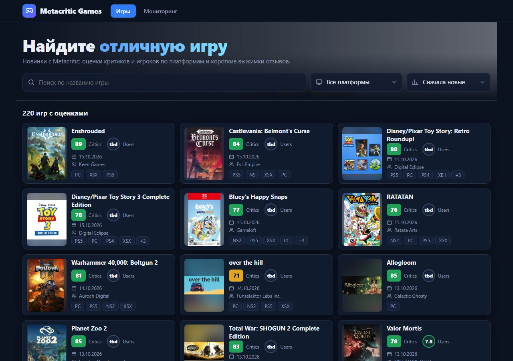
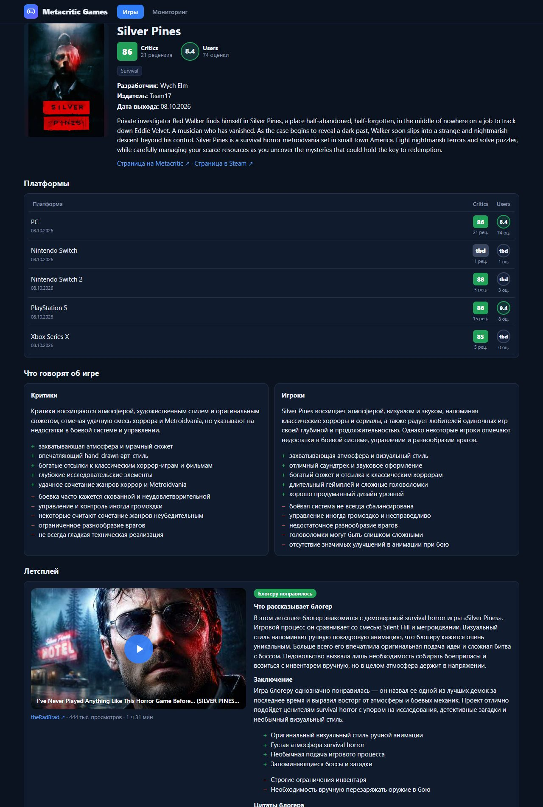
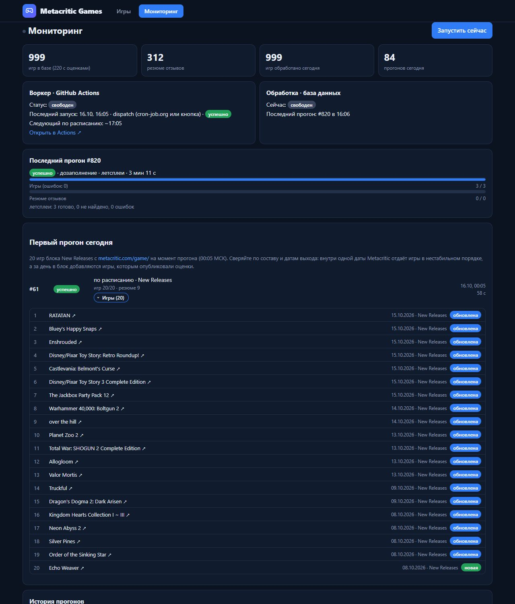

# Metacritic Games

- **Сайт:** https://skytec-metacritic.vercel.app/
- **Мониторинг и ручной запуск:** https://skytec-metacritic.vercel.app/monitor
- **Telegram-бот (сайт как Mini App):** [@skytecmetacriticbot](https://t.me/skytecmetacriticbot)
- **Репозиторий:** https://github.com/NellasTerton/skytec-metacritic

<p>
  <a href="docs/img/list.jpg"></a>
  <a href="docs/img/game.jpg"></a>
  <a href="docs/img/monitor.jpg"></a>
</p>

Сервис раз в час забирает новые игры с Metacritic, сохраняет карточки с оценками по
платформам, пишет LLM-резюме отзывов критиков и игроков, находит летсплей и пересказывает
мнение блогера, показывает всё это на сайте. Тестовое задание Skytec Games (AI Automation
Engineer). Бюджет нулевой: только бесплатные тарифы, без карты.

> **Начальное наполнение базы.** Ежечасный обход из ТЗ берёт свежие релизы, а Metacritic
> публикует оценки через дни и недели после выхода, поэтому в первые дни работы почти все
> собранные игры без оценок. Чтобы в каталоге сразу было что смотреть, база один раз
> дозаполнена ~200 последними играми с оценками (`python -m app.worker seed --count 200`:
> finder с `metaScoreMin=1` начиная с 21-й позиции, т. е. дальше блока New Releases), для них
> написаны резюме и посчитаны эмбеддинги. Это разовая операция, **не часть ежечасной
> логики из ТЗ**: воркер её не вызывает. В мониторинге такие прогоны подписаны «разово».

## Что сделано по ТЗ

| Требование | Как сделано | Где |
|---|---|---|
| Раз в час 20 игр, не обработанных сегодня | cron-job.org в :05 → `/api/cron` → `workflow_dispatch` воркера в GitHub Actions; «обработана сегодня» — по `run_items` за день по Москве | [worker.yml](.github/workflows/worker.yml), [app/worker/runner.py](app/worker/runner.py) |
| Сначала New Releases с /game/, потом SEE ALL → Newest, каждый день заново | Первый прогон дня берёт блок New Releases, следующие идут по SEE ALL с курсором в БД; новый день — новый курсор | [app/worker/selection.py](app/worker/selection.py) |
| Название, обложка, платформы с Metascore и User score, разработчик, описание, ссылка на видео | Внутренний API Metacritic (официального нет): composer карточки + оценки по каждой платформе | [app/metacritic/](app/metacritic/), [app/models.py](app/models.py) |
| LLM-резюме отзывов критиков и игроков отдельно, обновляются при повторном заходе | Одно обращение на игру, JSON с двумя резюме; пересчёт, только если изменился набор отзывов (хэш). Groq `gpt-oss-120b`, при лимите — Gemini | [app/summaries.py](app/summaries.py), [app/llm.py](app/llm.py) |
| Веб: список, карточка, фильтр по платформе, поиск, сортировка по рейтингу | FastAPI + Jinja2 на Vercel. Поиск при вводе, фильтр и сортировка с оценками выбранной платформы; сверху игры с оценками, ниже свежие релизы без оценок | [app/main.py](app/main.py), [app/queries.py](app/queries.py), [app/templates/](app/templates/) |
| Похожие игры с переходом на карточку | Эмбеддинги описаний (Gemini, pgvector) + общие жанры и разработчик; игры с оценками выше | [app/embeddings.py](app/embeddings.py), `similar_games` в [app/queries.py](app/queries.py) |
| Доп. 1: самый популярный летсплей → речь блогера → вывод | YouTube Data API ищет самый просматриваемый летсплей. Речь в текст: в облаке субтитры YouTube недоступны, поэтому Gemini смотрит ролик по ссылке (начало, середина, конец) и пишет пересказ речи блогера; полная расшифровка — только если доступны субтитры (локальный запуск). По тексту — вывод: понравилась ли игра блогеру и почему | [app/letsplay.py](app/letsplay.py), `letsplay_backlog` в [runner.py](app/worker/runner.py) |
| Доп. 2: мониторинг в реальном времени и кнопка запуска | `/monitor` опрашивает `/api/status` раз в 2,5 с; каждый прогон раскрывается списком игр (ссылка на Metacritic, дата выхода, новая/обновлена); первый прогон дня закреплён отдельно; «Запустить сейчас» → `workflow_dispatch` | [monitor.html](app/templates/monitor.html), [app/github.py](app/github.py) |

**Видео.** Ссылка на видео с карточки Metacritic сохраняется в `games.video_url` и
показывается в плеере первой. Видео у Metacritic есть не у всех игр, поэтому дополнительно
ищется трейлер на YouTube — он идёт второй вкладкой или единственным видео.

SEE ALL постранично с сайтом совпадать не обязан: у игр с одинаковой датой выхода Metacritic
отдаёт нестабильный порядок (даже в New Releases), поэтому воркер не опирается на номера
страниц, а пропускает уже обработанные сегодня игры. Первый прогон дня сверяется с блоком
New Releases по составу и датам выхода.

## Сверх ТЗ

- **Перепроверка свежих игр без оценок** — раз в сутки воркер заново читает игры младше 30 дней без оценок: обход SEE ALL доходит лишь на ~4 дня вглубь, а оценки появляются позже (`recheck_backlog` в [runner.py](app/worker/runner.py)).
- **Медиа** — встроенный плеер, трейлер с YouTube для игр без видео Metacritic и скриншоты из Steam ([app/media.py](app/media.py)).
- **Похожие игры по смыслу описания** — эмбеддинги Gemini в pgvector вместо одного совпадения жанров; ближайшие помечены «похожее описание».
- **Летсплеи подробнее «вывода»** — плюсы и минусы по мнению блогера, дословные цитаты с переводом на русский, проверка, что ролик именно про эту игру.
- **Экономные резюме** — фолбэк Groq → Gemini при исчерпании лимита, пересчёт только при изменении набора отзывов (хэш).
- **Мониторинг для сверки** — список игр каждого прогона, закреплённый первый прогон дня, защита от двойного запуска.
- **Главная** — блок «Свежие релизы, оценок пока нет» с пометкой «вышла N дней назад», поиск при вводе, вёрстка под телефон.
- **Telegram-бот [@skytecmetacriticbot](https://t.me/skytecmetacriticbot)** — /start с кнопкой Mini App; в Telegram сайт берёт тему клиента и системную «Назад» ([app/telegram.py](app/telegram.py)).
- **Секреты не попадают в логи** — ключ YouTube в заголовке, URL запросов не логируются, вебхук бота с секретным токеном; проверено по логам Actions и Vercel, истории git и переписке.
- **Тесты и CI** — 103 офлайн-теста на сохранённых ответах Metacritic плюс тесты на настоящей БД; ruff и pytest в [ci.yml](.github/workflows/ci.yml).
- **Документация** — исследование внутреннего API Metacritic ([docs/metacritic-research.md](docs/metacritic-research.md)) и обоснование инфраструктуры ([docs/infrastructure.md](docs/infrastructure.md)).

## Архитектура

```
cron-job.org (каждый час в :05)
   └─ GET /api/cron, Bearer CRON_SECRET ─┐
                                         ▼
Telegram ── webhook ──> Vercel: FastAPI (app/main.py) ── читает ──> Neon Postgres + pgvector
  бот, Mini App ──────> сайт, /monitor, /api/*                          ▲
                           │ workflow_dispatch (GITHUB_DISPATCH_TOKEN)  │ пишет
                           ▼                                            │
                     GitHub Actions: python -m app.worker ──────────────┘
                       run · recheck · summarize · media · embeddings · letsplays
                         ├─ backend.metacritic.com
                         ├─ Groq / Gemini (резюме, летсплеи, эмбеддинги)
                         └─ YouTube Data API, yt-dlp, Steam Store API
```

- `app/metacritic/` — клиент внутреннего API Metacritic. Как он устроен и где подвохи:
  [docs/metacritic-research.md](docs/metacritic-research.md).
- `app/worker/` — воркер: выборка, сбор, резюме, медиа, эмбеддинги, летсплеи, перепроверка.
- `app/main.py` — сайт и API; `app/telegram.py` — бот: на /start приветствие с кнопкой Mini App,
  внутри Telegram сайт берёт цвета темы клиента и показывает системную «Назад».
- `app/models.py`, `migrations/` — схема БД, Alembic.
- `probe/` — зонд, которым в начале проверяли доступ к Metacritic из GitHub Actions и Vercel
  (облачные IP не блокируются); в работе сервиса не участвует.
- Почему такая инфраструктура и какие у бесплатных тарифов лимиты:
  [docs/infrastructure.md](docs/infrastructure.md).

## Локальный запуск

```bash
python -m venv .venv
.venv/Scripts/pip install -r requirements-dev.txt   # Linux/macOS: .venv/bin/pip
cp .env.example .env                                 # вписать строки подключения Neon и ключи
alembic upgrade head
python -m app.worker new-releases                    # без БД: список New Releases
python -m app.worker game elden-ring                 # без БД: карточка игры в JSON
python -m app.worker run                             # прогон с записью в БД
python -m app.worker recheck                         # перепроверка свежих игр без оценок (раз в сутки)
python -m app.worker summarize --limit 20            # резюме для игр в БД, у которых их нет
python -m app.worker media --limit 40                # трейлеры и скриншоты для игр без них
python -m app.worker embeddings --limit 300          # эмбеддинги описаний (похожие игры)
python -m app.worker letsplays --limit 3             # летсплеи для игр с оценками
python -m app.worker seed --count 200                # разово: начальное наполнение (см. выше)
uvicorn app.main:app --reload                        # сайт на http://127.0.0.1:8000
```

## Тесты

```bash
pytest                    # офлайн, на фикстурах из tests/fixtures/metacritic
python -m scripts.capture_fixtures   # обновить фикстуры
```

Тесты БД запускаются, только если задан `DATABASE_URL` в окружении (не из .env). В GitHub
Actions тесты и ruff гоняет [ci.yml](.github/workflows/ci.yml).

## Деплой

- **Neon:** создать проект, `DATABASE_URL` (pooled) и `DATABASE_URL_UNPOOLED` (direct).
  Расширение `vector` включает миграция.
- **GitHub Actions** (Settings → Secrets → Actions): `DATABASE_URL`, `DATABASE_URL_UNPOOLED`,
  `GROQ_API_KEY` и `GEMINI_API_KEY` (резюме; Gemini — фолбэк и эмбеддинги, летсплеи),
  `YOUTUBE_API_KEY` (поиск летсплеев). Без ключа соответствующий шаг пропускается.
- **Vercel:** `DATABASE_URL`, `CRON_SECRET` и `GITHUB_DISPATCH_TOKEN` (fine-grained PAT только на
  этот репозиторий, Actions: read & write). В Deployment Protection отключить Vercel
  Authentication, иначе сайт будет закрыт логином.
- **Ежечасный запуск:** задача на cron-job.org раз в час делает `GET https://<сайт>/api/cron`
  с заголовком `Authorization: Bearer <CRON_SECRET>`.
- **Telegram-бот (необязательно):** `TELEGRAM_BOT_TOKEN` и `TELEGRAM_WEBHOOK_SECRET` (любая
  случайная строка) в Vercel, затем один раз `python -m scripts.telegram_setup` с теми же
  переменными — он ставит вебхук, команду /start, описание бота и кнопку меню с Mini App.

## Ограничения

- **Нет официального API Metacritic.** Используется внутренний `backend.metacritic.com`, тот же,
  что у их сайта; при смене формата сломается парсер (тесты на фикстурах это поймают).
- **Глубина обхода.** 20 игр в час — это ~440 позиций SEE ALL в сутки, примерно 4 дня релизов.
  Игры глубже за день не обходятся; свежие игры без оценок 30 дней перепроверяются ежедневно.
- **Неопубликованные оценки.** Если у Metacritic есть отзывы, но оценка ещё не опубликована
  (`sentiment: null`), на сайте «tbd», игра в блоке «оценок пока нет».
- **Летсплеи.** Поиск YouTube ограничен 100 запросами в сутки, поэтому 3 игры в час.
  Субтитры YouTube из облака недоступны («Sign in to confirm you're not a bot»), поэтому
  Gemini смотрит три фрагмента ролика (начало, середина, конец), а не всю речь; полная
  расшифровка есть только у роликов, обработанных локально. Gemini нередко отвечает 503 —
  такие игры перепроверяются через сутки.
- **Лимиты LLM.** Groq даёт 200 тыс. токенов в сутки (~60 резюме); дальше резюме пишет Gemini.
  Если исчерпаны оба, резюме дописываются в следующих прогонах.
- **Время.** Vercel Hobby хранит логи 1 час — история прогонов поэтому в своей БД. Neon
  засыпает после 5 минут простоя: первый запрос к сайту после паузы медленнее (~1 с).
- **Кнопка «Запустить сейчас»** доступна всем, кто открыл `/monitor`: авторизации нет, но
  второй прогон не стартует, пока идёт первый.
